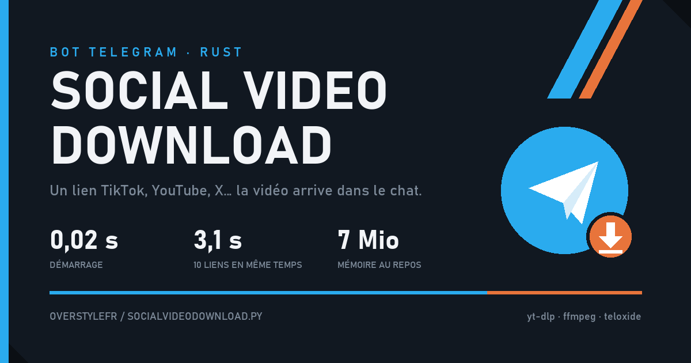

Bot Telegram qui télécharge les vidéos des réseaux sociaux : on lui envoie un lien TikTok, YouTube, X ou Bluesky et la vidéo (ou son audio) arrive directement dans le chat.
Cette version est une refonte complète en Rust, avec yt-dlp, ffmpeg et teloxide.
Elle démarre en 0,02 s, traite 10 liens en même temps en 3,1 s et tient dans 7 Mio de mémoire au repos.
Les liens déjà envoyés repartent du cache, les demandes s'enchaînent dans une file d'attente et les fichiers trop lourds passent par un hébergeur externe après accord.
